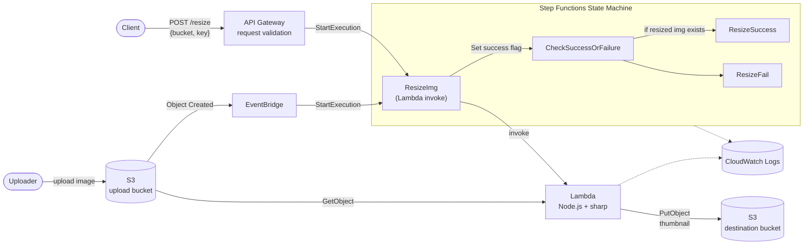

# CCMP Capstone Project: Serverless Image Processing Pipeline
Capstone project for CCMP-200 Cloud Computing, BIS

IaC using AWS SAM (Serverless Application Model) and AWS CloudFormation. All changes to the architecture is versioned with Git using this repository.
## Architecture


|Component|Path|
|---|---|
|Lambda source code| [resize-img/](./resize-img/) |
|SAM/CloudFormation Template| [template.yml](./template.yaml)|
|State Machine definition| [state-machine.asl.json](./state-machine.asl.json) |

The Lambda function does not utilize the `sharp` NodeJS Lambda layer, rather it includes the package as a dependency inside `package.json`
## Instructions
### Deployment
1. Create an AWS account. 
2. Either: 
    - Install [AWS SAM CLI](https://docs.aws.amazon.com/serverless-application-model/latest/developerguide/prerequisites.html) on your local machine, or
    - Open CloudShell from AWS Console
3. Clone this repository: 
```sh
git clone https://github.com/jaerri/CCMP-Capstone.git 
cd CCMP-Capstone
```
4. Build the SAM template and deploy it using CloudFormation:
```sh
sam build && sam deploy
```
5. Review the changeset, and press `y` and Enter to proceed with creating the stack.
6. Wait for the stack to finish creating before continuing.

### Usage
1. **Identify the S3 buckets:** 
Open the CloudFormation Console page, find stack with name `CCMP-ResizeImg`. Go to Outputs, find `UploadBucket` and `DestinationBucket`. There we can find the bucket where we can upload images to or download the resized images from.
2. **Upload image** (should be wider or taller than 200px): 
    - Use `aws s3 cp <file> <endpoint>` to upload file to bucket, or 
    - Navigate to the bucket using the console and upload the image 
3. **Find resized thumbnail**: Navigate to `DestinationBucket` and download the new thumbnail. 
    - If there is no file present, check CloudWatch for the `/aws/vendedlogs/states/CCMP-ResizeImg-StateMachine` and `aws/lambda/CCMP-ResizeImg-Function` log group, or the AWS Step Functions console to see the errors.
4. (Optional) **Invoke State Machine through an HTTP API**
```sh
curl -X POST <ResizeApiEndpoint from CFN output> \
  -H "Content-Type: application/json" \
  -d '{"bucket": "<upload bucket>", "key": "<file in bucket>"}'
```

## License
Code licensed under MIT (c) 2026 Minh Khoa Le